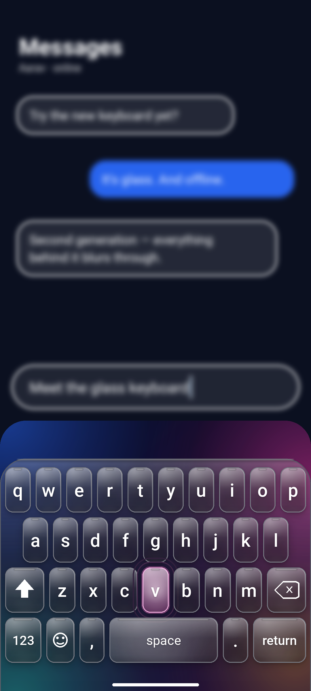
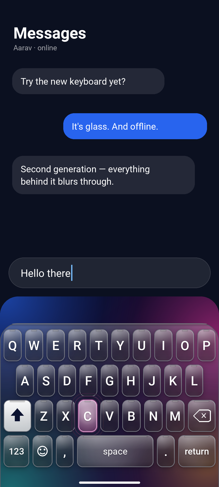
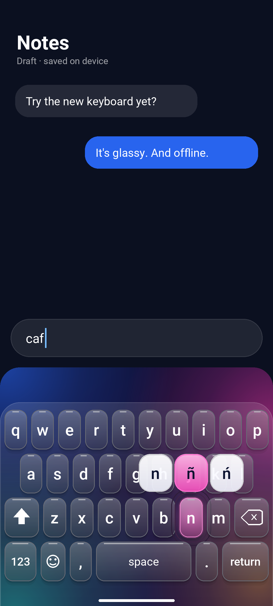
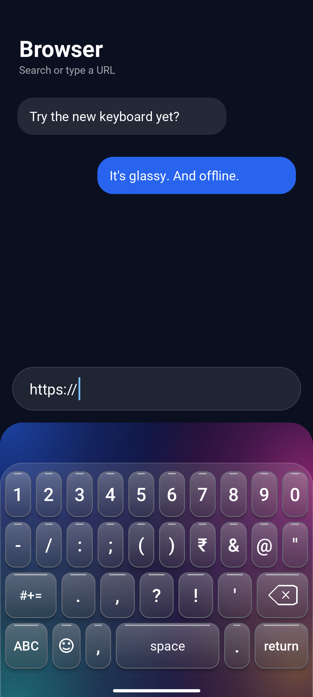
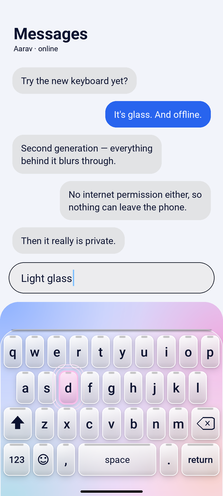
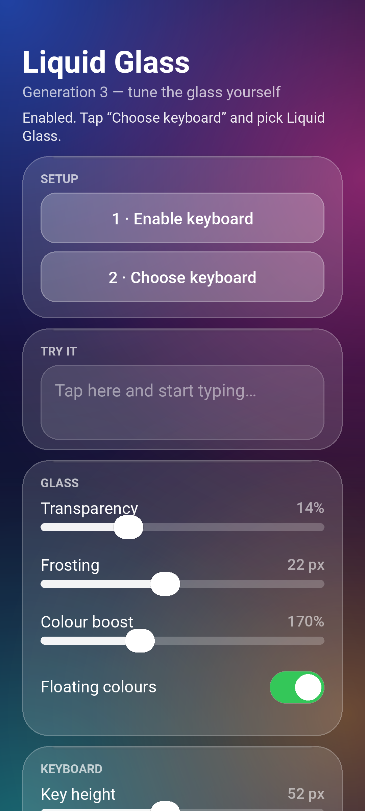

# Liquid Glass Keyboard

A real Android keyboard — a native `InputMethodService`, not a web page in a shell — with a
glassy, colour-shifting keypad. Fully offline: the APK requests no internet permission at all.

[](https://github.com/technicalnihilist-lgtm/liquid-glass-keyboard/actions/workflows/build.yml)
[](LICENSE)
[](#permissions)

<p align="center">
  
  
  
</p>

## Download

**[LiquidGlassKeyboard.apk](https://github.com/technicalnihilist-lgtm/liquid-glass-keyboard/releases/latest/download/LiquidGlassKeyboard.apk)**
— 186 KB, signed, `minSdk 21` (Android 5.0+), `targetSdk 34`. The same file also sits in the repo
root as `LiquidGlassKeyboard.apk`.

Verify the download before installing:

```bash
sha256sum LiquidGlassKeyboard.apk     # compare with SHA256SUMS in this repo
```

Install it, open the app, then:

1. Tap **Enable keyboard** → turn on *Liquid Glass Keyboard* in the system list.
2. Tap **Choose keyboard** → pick *Liquid Glass Keyboard*.

The app shows your live status, so you can tell whether it is enabled and whether it is the
keyboard currently in use. There is a text box on the same screen to try it out immediately.

## Open source

MIT licensed, and small enough to read in one sitting: seven Java files, no dependencies, no
Gradle, no third-party libraries, no generated code. `build.sh` is the entire build system —
`aapt2` for resources, `javac`, `d8` for dexing, `zipalign`, `apksigner`.

That means you can audit the thing that types your messages:

| File | Lines | What it does |
|---|---|---|
| `LiquidImeService.java` | ~190 | the input method: commits text, backspace, enter, asks for window blur |
| `KeyboardView.java` | ~900 | all drawing and touch handling |
| `KeyboardLayout.java` | ~180 | pages, key weights, long-press alternates |
| `GlassPalette.java` | ~150 | colour tokens and preferences |
| `GlassBackdrop.java` | ~70 | gradient sky and drifting orbs |
| `Key.java` | ~50 | one key |
| `SetupActivity.java` | ~200 | enable/choose flow and settings |

Continuous integration builds the APK on every push and **fails if the resulting binary ever
requests the `INTERNET` permission** — the offline promise is enforced by the build, not just by
this paragraph. CI builds are signed with a throwaway key and are for testing only.

Everything needed to rebuild what is published is here: sources, resources, `build.sh`, the icon
generator, the screenshot renderer, and the original HTML mock-up in `design/` that the look came
from. See [CONTRIBUTING.md](CONTRIBUTING.md) to build it yourself, [CHANGELOG.md](CHANGELOG.md)
for what changed when, and [SECURITY.md](SECURITY.md) to report a problem privately.

F-Droid metadata lives in `fastlane/metadata/android/`, so listing the app there needs no extra
work beyond F-Droid's own build recipe.

## Generation 3 — tune the glass

The third design pass hands the material over to you. The setup screen now carries the same
controls the mock-up had, wired to the real renderer:

- **Transparency** (0–45%) scales every glass alpha — at zero you are left with rims and text on a
  bare backdrop.
- **Frosting** (0–50 px) sets the radius of the real window blur on Android 12+; at 0 the board
  drops its own paint to nothing and sits on an unblurred app.
- **Colour boost** (100–300%) scales the alpha of the drifting orbs.
- **Floating colours** switches the orbs off entirely.
- **Key height** (38–70 px) and **space between keys** (2–14 px) are sliders now, not presets.
- **Glow on press** turns the flare, bloom and halo off, leaving only the tint and the rim.
- **Bounce** (0–100%) controls how far a key sinks under your finger — up to 14% — and how long
  the flash lasts.
- **Auto / Light / Dark** segmented control, and a reset button that restores every default.

## Generation 2 — layered glass

Version 1 drew each key as a single translucent gradient. Version 2 builds every key out of
layers, the way real glass behaves:

- **Specular rim** along the top edge of each key, blurred so it reads as a reflection rather
  than a line, plus an inner rim that runs bright at the top and fades to nothing at the base.
- **A body that thins downwards** — three gradient stops instead of two, so the key is dense where
  light hits it and almost clear at the bottom.
- **A caustic pool** of light gathering along the base of every key, and a light source in the
  upper left of each pane.
- **Contact shadows** — a tight shadow under the glass and a wide ambient one beneath it, so keys
  sit *on* the sheet instead of floating above it.
- **Real backdrop blur.** On Android 12+ the window asks the system to blur whatever app is
  behind it (`FLAG_BLUR_BEHIND`, 26 dp radius). The keyboard then drops its own paint to a thin
  veil, so you type over a frosted version of the actual screen. Where cross-window blur is
  unavailable it silently falls back to the painted backdrop — nothing breaks.
- **Deeper transparency.** Key bodies are lighter and the plate is thinner, so the colour orbs
  behind the board bleed through the glass instead of being covered by it.
- **Drifting orbs.** The four colour orbs move slowly while the keyboard is visible; switchable in
  settings if you would rather have a still board.
- **Baked rendering.** The static glass (plate and every key body, shadows and rims included) is
  rendered once into a bitmap and reused; only labels, the pressed key and the flare are redrawn
  per frame. More layers, less work per frame than version 1.

## What it does

- Full QWERTY with shift, double-tap caps lock, and automatic capitals at the start of a sentence.
- Three symbol pages (letters, numbers, symbols) plus an emoji page of 48 characters.
- Long-press a key for accented variants — `e` gives è é ê ë ē ė ę, and 16 letters carry alternates.
  Slide to the character you want and let go; the base character is swapped for it.
- Backspace deletes one character, repeats while held, removes whole selections, and steps over
  emoji rather than splitting them in half.
- The return key adapts to the field: it reads *send*, *search*, *go*, *next*, *done* or *prev* and
  triggers the right editor action, falling back to a newline in multi-line fields.
- Every press rotates the accent hue and throws a glow and a colour flare, exactly as the original
  HTML mock-up did — but drawn on a `Canvas` at 60 fps rather than in a browser.
- Popup preview above the key you are pressing, key-click sound and haptic tap (both switchable).
- Dark glass, light glass, or follow the system theme. Three key heights.

## What it deliberately does not do

No predictive text, no autocorrect, no swipe typing, no clipboard history, no cloud anything.
It types what you press and nothing else. Nothing leaves the device, and there is no network code
in the APK to leave with.

## Screenshots

| | |
|---|---|
|  |  |
| Gen 2 glass over a blurred app | Numbers and symbols page |
|  |  |
| Light glass | Setup, live status and preferences |

The screenshots are rendered from the same geometry, colours, gradient stops and rim widths the
keyboard draws with (`tools/render_shots.py` mirrors `KeyboardView`), so they match what the APK
puts on screen. The hero shot shows the Android 12+ backdrop blur; on older versions the board
falls back to its painted backdrop.

## Repository

```
app/
  AndroidManifest.xml          IME service + setup activity
  java/com/liquidglass/keyboard/
    LiquidImeService.java      InputMethodService: commits text, window blur, enter/backspace
    KeyboardView.java          layered glass drawing, baked bitmap, touch, glow and flare
    KeyboardLayout.java        every page's rows, weights and long-press alternates
    GlassPalette.java          colour tokens, HSL helper, preferences
    GlassBackdrop.java         gradient sky + drifting colour orbs
    SetupActivity.java         enable/choose flow, live status, preferences
  res/                         styles, glass drawables, layout, launcher icons, IME metadata
build.sh                       aapt2 → javac → d8 → zipalign → apksigner
tools/                         icon generator and screenshot renderer
design/                        the original HTML mock-up, kept for provenance
fastlane/                      F-Droid metadata
.github/workflows/build.yml    CI: build, verify permissions, upload artifact
```

To build it yourself:

```bash
export JAVA_HOME=/path/to/jdk-17
export ANDROID_HOME=/path/to/android-sdk     # needs build-tools 34.0.0 and platforms/android-34
bash build.sh
```

The signing key is created on first run at `~/.liquidglass/keyboard.jks` (override with `KS` and
`KSPASS`). Replace it with your own key if you plan to publish — builds signed with a different key
cannot update over this one.

## Permissions

`VIBRATE` only. There is no `INTERNET` permission, so the app cannot phone home even in principle.

## Licence

MIT — see [LICENSE](LICENSE). Every source file carries the licence header. Use it, fork it,
ship it in a product; just keep the copyright notice.

---

## ⭐ Like this work? Give it a star

If you like this app and our work, please **star this repository** ⭐ and **[follow technicalnihilist-lgtm on GitHub](https://github.com/technicalnihilist-lgtm)**. If our work isn't for you, that's completely fine — the choice is yours. Thank you for stopping by!

<details>
<summary><b>🌍 Same message in 32 languages (A–Z + Indian languages)</b></summary>

- **A — Arabic** (العربية): ⭐ إذا أعجبك هذا التطبيق وعملنا، فيرجى منح المستودع نجمة ومتابعتنا. وإذا لم يعجبك عملنا، فلا مشكلة على الإطلاق — القرار قرارك. شكرًا لزيارتك!
- **B — Bengali** (বাংলা): ⭐ যদি আপনার এই অ্যাপ এবং আমাদের কাজ ভালো লাগে, তবে অনুগ্রহ করে রিপোজিটরিটিকে একটি স্টার দিন এবং আমাদের ফলো করুন। আমাদের কাজ যদি আপনার পছন্দ না হয়, তাতেও কোনো সমস্যা নেই — সিদ্ধান্ত আপনার। আমাদের পেজে আসার জন্য ধন্যবাদ!
- **C — Chinese** (中文): ⭐ 如果你喜欢这个应用和我们的作品，请给仓库点个星标并关注我们。如果我们的作品不适合你，也完全没关系——选择权在你。感谢你的到访！
- **D — Dutch** (Nederlands): ⭐ Vind je deze app en ons werk leuk? Geef de repository dan een ster en volg ons. Vind je ons werk niets, dan is dat helemaal prima — de keuze is aan jou. Bedankt voor je bezoek!
- **E — English** (English): ⭐ If you like this app and our work, please give the repository a star and follow us. If our work isn't for you, that's completely fine — the choice is yours. Thank you for stopping by!
- **F — French** (Français): ⭐ Si cette application et notre travail vous plaisent, mettez une étoile au dépôt et suivez-nous. Si notre travail n'est pas pour vous, aucun souci — c'est votre choix. Merci de votre visite !
- **G — German** (Deutsch): ⭐ Wenn dir diese App und unsere Arbeit gefallen, gib dem Repository einen Stern und folge uns. Wenn unsere Arbeit nichts für dich ist, ist das völlig in Ordnung — die Wahl liegt bei dir. Danke fürs Vorbeischauen!
- **H — Hindi** (हिन्दी): ⭐ अगर आपको यह ऐप और हमारा काम पसंद है, तो कृपया रिपॉजिटरी को स्टार दें और हमें फॉलो करें। अगर हमारा काम आपके लिए नहीं है, तो भी कोई बात नहीं — यह पूरी तरह आपकी मर्ज़ी है। यहाँ आने के लिए आपका धन्यवाद!
- **I — Indonesian** (Bahasa Indonesia): ⭐ Jika kamu suka aplikasi ini dan karya kami, beri bintang pada repositori ini dan ikuti kami. Kalau karya kami bukan untukmu, tidak masalah sama sekali — itu pilihanmu. Terima kasih sudah mampir!
- **J — Japanese** (日本語): ⭐ このアプリと私たちの仕事が気に入ったら、リポジトリにスターを付けてフォローしてください。合わない場合はまったく問題ありません — 選ぶのはあなたです。お越しいただきありがとうございます！
- **K — Korean** (한국어): ⭐ 이 앱과 저희 작업이 마음에 드신다면 저장소에 스타를 눌러 주시고 팔로우해 주세요. 저희 작업이 맞지 않으셔도 전혀 괜찮습니다 — 선택은 여러분의 몫입니다. 방문해 주셔서 감사합니다!
- **L — Lithuanian** (Lietuvių): ⭐ Jei tau patinka ši programa ir mūsų darbas, duok saugyklai žvaigždutę ir sek mus. Jei mūsų darbas ne tau, viskas gerai — pasirinkimas tavo. Ačiū, kad užsukai!
- **M — Malayalam** (മലയാളം): ⭐ നിങ്ങൾക്ക് ഈ ആപ്പും ഞങ്ങളുടെ പ്രവർത്തനവും ഇഷ്ടപ്പെട്ടെങ്കിൽ, ദയവായി റെപ്പോസിറ്ററിക്ക് ഒരു സ്റ്റാർ നൽകുകയും ഞങ്ങളെ ഫോളോ ചെയ്യുകയും ചെയ്യുക. ഞങ്ങളുടെ പ്രവർത്തനം നിങ്ങൾക്ക് അനുയോജ്യമല്ലെങ്കിൽ, അതും തികച്ചും കുഴപ്പമില്ല — തീരുമാനം നിങ്ങളുടേതാണ്. ഇവിടെ വന്നതിന് നന്ദി!
- **N — Nepali** (नेपाली): ⭐ यदि तपाईंलाई यो एप र हाम्रो काम मन पर्‍यो भने, कृपया रिपोजिटरीलाई स्टार दिनुहोस् र हामीलाई फलो गर्नुहोस्। यदि हाम्रो काम तपाईंलाई मन पर्दैन भने, पनि ठीकै छ — यो तपाईंको इच्छा हो। यहाँ आउनुभएकोमा धन्यवाद!
- **O — Odia** (ଓଡ଼ିଆ): ⭐ ଯଦି ଆପଣଙ୍କୁ ଏହି ଆପ୍ ଏବଂ ଆମର କାମ ଭଲ ଲାଗୁଛି, ତେବେ ଦୟାକରି ରିପୋଜିଟୋରୀକୁ ଗୋଟିଏ ଷ୍ଟାର୍ ଦିଅନ୍ତୁ ଏବଂ ଆମକୁ ଫଲୋ କରନ୍ତୁ। ଯଦି ଆମର କାମ ଆପଣଙ୍କ ପାଇଁ ନୁହେଁ, ତେବେ କିଛି ଅସୁବିଧା ନାହିଁ — ପସନ୍ଦ ଆପଣଙ୍କର। ଆମ ପାଖକୁ ଆସିଥିବାରୁ ଧନ୍ୟବାଦ!
- **P — Polish** (Polski): ⭐ Jeśli podoba Ci się ta aplikacja i nasza praca, daj repozytorium gwiazdkę i obserwuj nas. Jeśli nasza praca nie jest dla Ciebie, to zupełnie w porządku — wybór należy do Ciebie. Dziękujemy za odwiedziny!
- **Q — Quechua** (Runa Simi): ⭐ Kay app, ñuqaykup ruwasqanchikpas gustasunki chayqa, repositorioman huk estrella churay, ñuqaykutapas qatipayku. Mana gustasunki chayqa, allinmi — qampa akllayki. Hamusqaykimanta sulpayki!
- **R — Russian** (Русский): ⭐ Если вам нравится это приложение и наша работа, поставьте звёздочку репозиторию и подпишитесь на нас. Если наша работа не для вас — это совершенно нормально, выбор за вами. Спасибо, что заглянули!
- **S — Spanish** (Español): ⭐ Si te gusta esta app y nuestro trabajo, dale una estrella al repositorio y síguenos. Si nuestro trabajo no es para ti, no pasa nada — la decisión es tuya. ¡Gracias por pasarte!
- **T — Tamil** (தமிழ்): ⭐ உங்களுக்கு இந்த ஆப்பும் எங்க வேலையும் பிடிச்சிருந்தா, தயவுசெஞ்சு இந்த ரெபாசிட்டரிக்கு ஒரு ஸ்டார் குடுத்து, எங்களை ஃபாலோ பண்ணுங்க. எங்க வேலை உங்களுக்கு செட் ஆகலைன்னாலும் பரவாயில்லை — அது உங்க விருப்பம். இங்கே வந்ததுக்கு நன்றி!
- **U — Urdu** (اردو): ⭐ اگر آپ کو یہ ایپ اور ہمارا کام پسند آئے تو براہ کرم ریپازٹری کو سٹار دیں اور ہمیں فالو کریں۔ اگر ہمارا کام آپ کے لیے نہیں ہے، تو یہ بالکل ٹھیک ہے — انتخاب آپ کا ہے۔ یہاں تشریف لانے کا شکریہ!
- **V — Vietnamese** (Tiếng Việt): ⭐ Nếu bạn thích ứng dụng này và công việc của chúng tôi, hãy tặng kho lưu trữ một ngôi sao và theo dõi chúng tôi. Nếu công việc của chúng tôi không phù hợp với bạn, điều đó hoàn toàn ổn — lựa chọn là của bạn. Cảm ơn bạn đã ghé qua!
- **W — Welsh** (Cymraeg): ⭐ Os ydych chi'n hoffi'r ap hwn a'n gwaith, rhowch seren i'r storfa a dilynwch ni. Os nad yw ein gwaith ar eich cyfer, mae hynny'n hollol iawn — chi sydd i benderfynu. Diolch am alw heibio!
- **X — Xhosa** (isiXhosa): ⭐ Ukuba uyayithanda le app nomsebenzi wethu, nika irepo inkwenkwezi kwaye usilandele. Ukuba umsebenzi wethu awukufanelanga, akukho ngxaki — lukhetho lwakho. Enkosi ngokutyelela!
- **Y — Yoruba** (Yorùbá): ⭐ Bí app yìí àti iṣẹ́ wa bá wù ọ́, jọ̀wọ́ fún àkójọpọ̀ náà ní ìràwọ̀ kí o sì tẹ̀lé wa. Bí iṣẹ́ wa kò bá yẹ ọ́, kò séwu — ìwọ ni ó yàn. Ẹ ṣé fún wíwá!
- **Z — Zulu** (isiZulu): ⭐ Uma uthanda le app nomsebenzi wethu, nikeza isitoreji inkanyezi bese usilandela. Uma umsebenzi wethu ungakufanele, akunankinga — wukukhetha kwakho. Siyabonga ngokuvakasha!

**More Indian languages**

- **Assamese** (অসমীয়া): ⭐ যদি আপুনি এই এপটো আৰু আমাৰ কাম ভাল পায়, তেন্তে অনুগ্ৰহ কৰি ৰিপজিটৰীটোক এটা ষ্টাৰ দিয়ক আৰু আমাক ফ'ল' কৰক। যদি আমাৰ কাম আপোনাৰ বাবে নহয়, তেন্তে সেয়া একেবাৰে ঠিক আছে — সিদ্ধান্তটো আপোনাৰ। আমাৰ ইয়ালৈ অহাৰ বাবে ধন্যবাদ!
- **Gujarati** (ગુજરાતી): ⭐ જો તમને આ એપ અને અમારું કામ ગમતું હોય, તો પ્લીઝ રિપોઝિટરીને સ્ટાર આપો અને અમને ફોલો કરો. જો અમારું કામ તમને ન ગમતું હોય, તો તે પણ બરાબર છે — પસંદગી તમારી છે. અહીં આવવા બદલ આભાર!
- **Kannada** (ಕನ್ನಡ): ⭐ ನಿಮಗೆ ಈ ಆ್ಯಪ್ ಮತ್ತು ನಮ್ಮ ಕೆಲಸ ಇಷ್ಟವಾದರೆ, ದಯವಿಟ್ಟು ರೆಪೊಸಿಟರಿಗೆ ಸ್ಟಾರ್ ಕೊಡಿ ಮತ್ತು ನಮ್ಮನ್ನು ಫಾಲೋ ಮಾಡಿ. ನಮ್ಮ ಕೆಲಸ ನಿಮಗೆ ಸರಿಹೊಂದದಿದ್ದರೆ, ಅದೂ ಪರವಾಗಿಲ್ಲ — ಆಯ್ಕೆ ನಿಮ್ಮದು. ಭೇಟಿ ನೀಡಿದ್ದಕ್ಕೆ ಧನ್ಯವಾದಗಳು!
- **Marathi** (मराठी): ⭐ जर तुम्हाला हे ॲप आणि आमचं काम आवडलं असेल, तर कृपया रिपॉझिटरीला स्टार द्या आणि आम्हाला फॉलो करा. जर आमचं काम तुम्हाला आवडत नसेल, तर काही हरकत नाही — ती तुमची निवड आहे. इथे आल्याबद्दल धन्यवाद!
- **Punjabi** (ਪੰਜਾਬੀ): ⭐ ਜੇ ਤੁਹਾਨੂੰ ਇਹ ਐਪ ਅਤੇ ਸਾਡਾ ਕੰਮ ਪਸੰਦ ਹੈ, ਤਾਂ ਕਿਰਪਾ ਕਰਕੇ ਰਿਪੋਜ਼ਟਰੀ ਨੂੰ ਸਟਾਰ ਦਿਓ ਅਤੇ ਸਾਨੂੰ ਫਾਲੋ ਕਰੋ। ਜੇ ਸਾਡਾ ਕੰਮ ਤੁਹਾਡੇ ਲਈ ਨਹੀਂ ਹੈ, ਤਾਂ ਕੋਈ ਗੱਲ ਨਹੀਂ — ਚੋਣ ਤੁਹਾਡੀ ਹੈ। ਸਾਡੇ ਪੇਜ 'ਤੇ ਆਉਣ ਲਈ ਧੰਨਵਾਦ!
- **Telugu** (తెలుగు): ⭐ మీకు ఈ యాప్, మా పని నచ్చితే, దయచేసి రిపోజిటరీకి ఒక స్టార్ ఇచ్చి మమ్మల్ని ఫాలో అవ్వండి. ఒకవేళ మా పని మీకు నచ్చకపోతే, పర్వాలేదు — అది మీ ఇష్టం. మమ్మల్ని సందర్శించినందుకు ధన్యవాదాలు!

</details>
