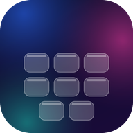
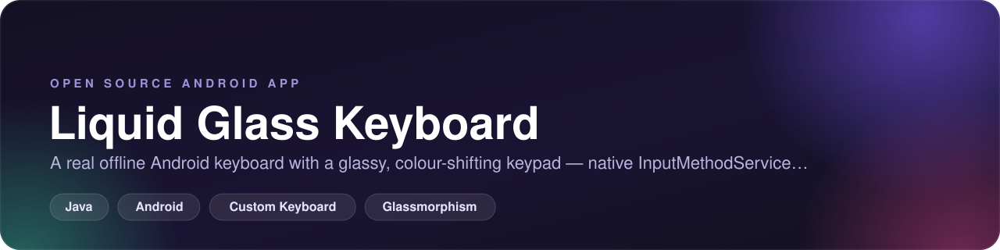
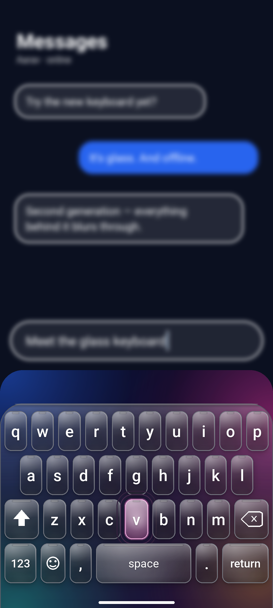
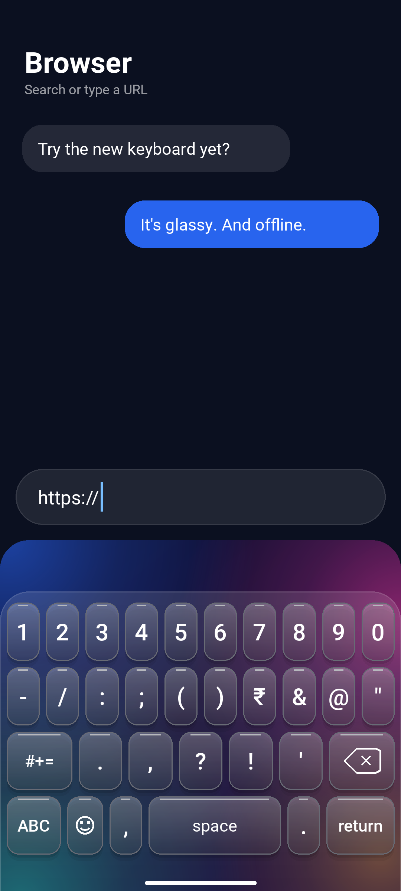
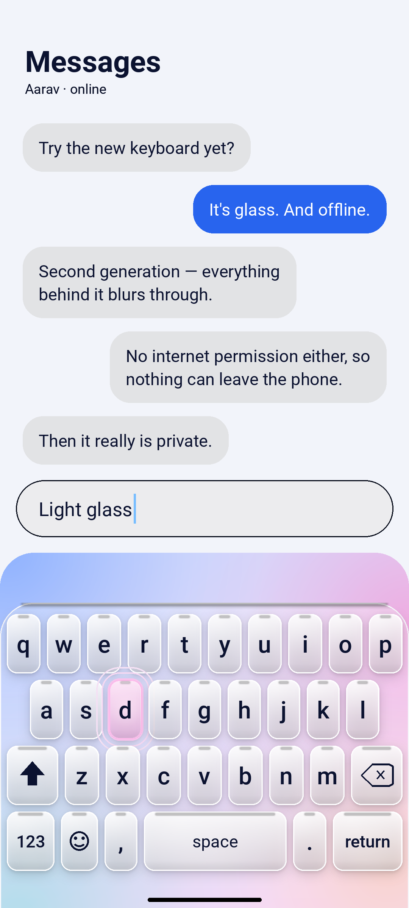
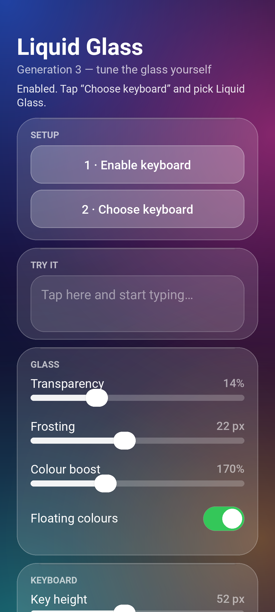

<div align="center">





<a href="https://github.com/technicalnihilist-lgtm/liquid-glass-keyboard/stargazers"></a>&nbsp;<a href="https://github.com/technicalnihilist-lgtm/liquid-glass-keyboard/network/members"></a>

<a href="https://github.com/technicalnihilist-lgtm/liquid-glass-keyboard/releases/latest/download/LiquidGlassKeyboard.apk"></a> <a href="https://technicalnihilist-lgtm.github.io/apps-site/apps/liquid-glass-keyboard.html"></a>

<b>Support the work</b>

  

<sub>Donations aren't live yet — Paytm, UPI, PayPal and Buy&nbsp;Me&nbsp;a&nbsp;Coffee all show <b>coming soon</b>. Until then, a ⭐ star is the best support.</sub>

<a href="https://github.com/technicalnihilist-lgtm/liquid-glass-keyboard/releases/latest"></a>  <a href="https://github.com/technicalnihilist-lgtm/liquid-glass-keyboard/releases"></a>

</div>

---

## Download

**[LiquidGlassKeyboard.apk](https://github.com/technicalnihilist-lgtm/liquid-glass-keyboard/releases/latest/download/LiquidGlassKeyboard.apk)**
— 186 KB, signed, `minSdk 21` (Android 5.0+), `targetSdk 34`. The same file also sits in the repo
root as `LiquidGlassKeyboard.apk`.

Verify the download before installing:

```bash
sha256sum LiquidGlassKeyboard.apk     # compare with SHA256SUMS in this repo
```

Install it, open the app, then:

1. Tap **Enable keyboard** → turn on *Liquid Glass Keyboard* in the system list.
2. Tap **Choose keyboard** → pick *Liquid Glass Keyboard*.

The app shows your live status, so you can tell whether it is enabled and whether it is the
keyboard currently in use. There is a text box on the same screen to try it out immediately.

## Open source

MIT licensed, and small enough to read in one sitting: seven Java files, no dependencies, no
Gradle, no third-party libraries, no generated code. `build.sh` is the entire build system —
`aapt2` for resources, `javac`, `d8` for dexing, `zipalign`, `apksigner`.

That means you can audit the thing that types your messages:

| File | Lines | What it does |
|---|---|---|
| `LiquidImeService.java` | ~190 | the input method: commits text, backspace, enter, asks for window blur |
| `KeyboardView.java` | ~900 | all drawing and touch handling |
| `KeyboardLayout.java` | ~180 | pages, key weights, long-press alternates |
| `GlassPalette.java` | ~150 | colour tokens and preferences |
| `GlassBackdrop.java` | ~70 | gradient sky and drifting orbs |
| `Key.java` | ~50 | one key |
| `SetupActivity.java` | ~200 | enable/choose flow and settings |

Continuous integration builds the APK on every push and **fails if the resulting binary ever
requests the `INTERNET` permission** — the offline promise is enforced by the build, not just by
this paragraph. CI builds are signed with a throwaway key and are for testing only.

Everything needed to rebuild what is published is here: sources, resources, `build.sh`, the icon
generator, the screenshot renderer, and the original HTML mock-up in `design/` that the look came
from. See [CONTRIBUTING.md](CONTRIBUTING.md) to build it yourself, [CHANGELOG.md](CHANGELOG.md)
for what changed when, and [SECURITY.md](SECURITY.md) to report a problem privately.

F-Droid metadata lives in `fastlane/metadata/android/`, so listing the app there needs no extra
work beyond F-Droid's own build recipe.

## Generation 3 — tune the glass

The third design pass hands the material over to you. The setup screen now carries the same
controls the mock-up had, wired to the real renderer:

- **Transparency** (0–45%) scales every glass alpha — at zero you are left with rims and text on a
  bare backdrop.
- **Frosting** (0–50 px) sets the radius of the real window blur on Android 12+; at 0 the board
  drops its own paint to nothing and sits on an unblurred app.
- **Colour boost** (100–300%) scales the alpha of the drifting orbs.
- **Floating colours** switches the orbs off entirely.
- **Key height** (38–70 px) and **space between keys** (2–14 px) are sliders now, not presets.
- **Glow on press** turns the flare, bloom and halo off, leaving only the tint and the rim.
- **Bounce** (0–100%) controls how far a key sinks under your finger — up to 14% — and how long
  the flash lasts.
- **Auto / Light / Dark** segmented control, and a reset button that restores every default.

## Generation 2 — layered glass

Version 1 drew each key as a single translucent gradient. Version 2 builds every key out of
layers, the way real glass behaves:

- **Specular rim** along the top edge of each key, blurred so it reads as a reflection rather
  than a line, plus an inner rim that runs bright at the top and fades to nothing at the base.
- **A body that thins downwards** — three gradient stops instead of two, so the key is dense where
  light hits it and almost clear at the bottom.
- **A caustic pool** of light gathering along the base of every key, and a light source in the
  upper left of each pane.
- **Contact shadows** — a tight shadow under the glass and a wide ambient one beneath it, so keys
  sit *on* the sheet instead of floating above it.
- **Real backdrop blur.** On Android 12+ the window asks the system to blur whatever app is
  behind it (`FLAG_BLUR_BEHIND`, 26 dp radius). The keyboard then drops its own paint to a thin
  veil, so you type over a frosted version of the actual screen. Where cross-window blur is
  unavailable it silently falls back to the painted backdrop — nothing breaks.
- **Deeper transparency.** Key bodies are lighter and the plate is thinner, so the colour orbs
  behind the board bleed through the glass instead of being covered by it.
- **Drifting orbs.** The four colour orbs move slowly while the keyboard is visible; switchable in
  settings if you would rather have a still board.
- **Baked rendering.** The static glass (plate and every key body, shadows and rims included) is
  rendered once into a bitmap and reused; only labels, the pressed key and the flare are redrawn
  per frame. More layers, less work per frame than version 1.

## What it does

- Full QWERTY with shift, double-tap caps lock, and automatic capitals at the start of a sentence.
- Three symbol pages (letters, numbers, symbols) plus an emoji page of 48 characters.
- Long-press a key for accented variants — `e` gives è é ê ë ē ė ę, and 16 letters carry alternates.
  Slide to the character you want and let go; the base character is swapped for it.
- Backspace deletes one character, repeats while held, removes whole selections, and steps over
  emoji rather than splitting them in half.
- The return key adapts to the field: it reads *send*, *search*, *go*, *next*, *done* or *prev* and
  triggers the right editor action, falling back to a newline in multi-line fields.
- Every press rotates the accent hue and throws a glow and a colour flare, exactly as the original
  HTML mock-up did — but drawn on a `Canvas` at 60 fps rather than in a browser.
- Popup preview above the key you are pressing, key-click sound and haptic tap (both switchable).
- Dark glass, light glass, or follow the system theme. Three key heights.

## What it deliberately does not do

No predictive text, no autocorrect, no swipe typing, no clipboard history, no cloud anything.
It types what you press and nothing else. Nothing leaves the device, and there is no network code
in the APK to leave with.

## Screenshots

| | |
|---|---|
|  |  |
| Gen 2 glass over a blurred app | Numbers and symbols page |
|  |  |
| Light glass | Setup, live status and preferences |

The screenshots are rendered from the same geometry, colours, gradient stops and rim widths the
keyboard draws with (`tools/render_shots.py` mirrors `KeyboardView`), so they match what the APK
puts on screen. The hero shot shows the Android 12+ backdrop blur; on older versions the board
falls back to its painted backdrop.

## Repository

```
app/
  AndroidManifest.xml          IME service + setup activity
  java/com/liquidglass/keyboard/
    LiquidImeService.java      InputMethodService: commits text, window blur, enter/backspace
    KeyboardView.java          layered glass drawing, baked bitmap, touch, glow and flare
    KeyboardLayout.java        every page's rows, weights and long-press alternates
    GlassPalette.java          colour tokens, HSL helper, preferences
    GlassBackdrop.java         gradient sky + drifting colour orbs
    SetupActivity.java         enable/choose flow, live status, preferences
  res/                         styles, glass drawables, layout, launcher icons, IME metadata
build.sh                       aapt2 → javac → d8 → zipalign → apksigner
tools/                         icon generator and screenshot renderer
design/                        the original HTML mock-up, kept for provenance
fastlane/                      F-Droid metadata
.github/workflows/build.yml    CI: build, verify permissions, upload artifact
```

To build it yourself:

```bash
export JAVA_HOME=/path/to/jdk-17
export ANDROID_HOME=/path/to/android-sdk     # needs build-tools 34.0.0 and platforms/android-34
bash build.sh
```

The signing key is created on first run at `~/.liquidglass/keyboard.jks` (override with `KS` and
`KSPASS`). Replace it with your own key if you plan to publish — builds signed with a different key
cannot update over this one.

## Permissions

`VIBRATE` only. There is no `INTERNET` permission, so the app cannot phone home even in principle.

## Licence

MIT — see [LICENSE](LICENSE). Every source file carries the licence header. Use it, fork it,
ship it in a product; just keep the copyright notice.

---

---

## 🌍 Languages

<sub>Donations are <b>coming soon</b> in every language below — nothing to pay today, nothing to click.</sub>

<div align="center">

<sub><b>हिन्दी · বাংলা · मराठी · తెలుగు · தமிழ் · ગુજરાતી · ಕನ್ನಡ · മലയാളം · ਪੰਜਾਬੀ · ଓଡ଼ିଆ · অসমীয়া · اردو</b></sub>

</div>

<details>
<summary><b>🌍 Open the same message in 53 languages</b></summary>

**🇮🇳 Indian languages**

- **हिन्दी** (Hindi) — ☕ जल्द ही आ रहा है। · ⭐ अगर आपको यह ऐप और हमारा काम पसंद है, तो कृपया रिपॉजिटरी को स्टार दें और हमें फॉलो करें।
- **বাংলা** (Bengali) — ☕ খুব শিগগিরই আসছে। · ⭐ যদি আপনার এই অ্যাপ এবং আমাদের কাজ ভালো লাগে, তবে অনুগ্রহ করে রিপোজিটরিটিকে একটি স্টার দিন এবং আমাদের ফলো করুন।
- **मराठी** (Marathi) — ☕ लवकरच येत आहे. · ⭐ जर तुम्हाला हे ॲप आणि आमचं काम आवडलं असेल, तर कृपया रिपॉझिटरीला स्टार द्या आणि आम्हाला फॉलो करा.
- **తెలుగు** (Telugu) — ☕ త్వరలో రాబోతోంది. · ⭐ మీకు ఈ యాప్, మా పని నచ్చితే, దయచేసి రిపోజిటరీకి ఒక స్టార్ ఇచ్చి మమ్మల్ని ఫాలో అవ్వండి.
- **தமிழ்** (Tamil) — ☕ விரைவில் வருகிறது. · ⭐ உங்களுக்கு இந்த ஆப்பும் எங்க வேலையும் பிடிச்சிருந்தா, தயவுசெஞ்சு இந்த ரெபாசிட்டரிக்கு ஒரு ஸ்டார்…
- **ગુજરાતી** (Gujarati) — ☕ ટૂંક સમયમાં આવી રહ્યું છે. · ⭐ જો તમને આ એપ અને અમારું કામ ગમતું હોય, તો પ્લીઝ રિપોઝિટરીને સ્ટાર આપો અને અમને ફોલો કરો.
- **ಕನ್ನಡ** (Kannada) — ☕ ಶೀಘ್ರದಲ್ಲೇ ಬರುತ್ತಿದೆ. · ⭐ ನಿಮಗೆ ಈ ಆ್ಯಪ್ ಮತ್ತು ನಮ್ಮ ಕೆಲಸ ಇಷ್ಟವಾದರೆ, ದಯವಿಟ್ಟು ರೆಪೊಸಿಟರಿಗೆ ಸ್ಟಾರ್ ಕೊಡಿ ಮತ್ತು ನಮ್ಮನ್ನು ಫಾಲೋ ಮಾಡಿ.
- **മലയാളം** (Malayalam) — ☕ ഉടൻ വരുന്നു. · ⭐ നിങ്ങൾക്ക് ഈ ആപ്പും ഞങ്ങളുടെ പ്രവർത്തനവും ഇഷ്ടപ്പെട്ടെങ്കിൽ, ദയവായി റെപ്പോസിറ്ററിക്ക് ഒരു സ്റ്റാർ…
- **ਪੰਜਾਬੀ** (Punjabi) — ☕ ਜਲਦੀ ਆ ਰਿਹਾ ਹੈ। · ⭐ ਜੇ ਤੁਹਾਨੂੰ ਇਹ ਐਪ ਅਤੇ ਸਾਡਾ ਕੰਮ ਪਸੰਦ ਹੈ, ਤਾਂ ਕਿਰਪਾ ਕਰਕੇ ਰਿਪੋਜ਼ਟਰੀ ਨੂੰ ਸਟਾਰ ਦਿਓ ਅਤੇ ਸਾਨੂੰ ਫਾਲੋ ਕਰੋ।
- **ଓଡ଼ିଆ** (Odia) — ☕ ଖୁବ୍ ଶୀଘ୍ର ଆସୁଛି। · ⭐ ଯଦି ଆପଣଙ୍କୁ ଏହି ଆପ୍ ଏବଂ ଆମର କାମ ଭଲ ଲାଗୁଛି, ତେବେ ଦୟାକରି ରିପୋଜିଟୋରୀକୁ ଗୋଟିଏ ଷ୍ଟାର୍ ଦିଅନ୍ତୁ ଏବଂ ଆମକୁ ଫଲୋ କରନ୍ତୁ।
- **অসমীয়া** (Assamese) — ☕ অতি সোনকালেই আহি আছে। · ⭐ যদি আপুনি এই এপটো আৰু আমাৰ কাম ভাল পায়, তেন্তে অনুগ্ৰহ কৰি ৰিপজিটৰীটোক এটা ষ্টাৰ দিয়ক আৰু আমাক ফ'ল' কৰক।
- **اردو** (Urdu) — ☕ جلد آرہا ہے۔ · ⭐ اگر آپ کو یہ ایپ اور ہمارا کام پسند آئے تو براہ کرم ریپازٹری کو سٹار دیں اور ہمیں فالو کریں۔
- **संस्कृतम्** (Sanskrit) — ☕ शीघ्रमेव आगच्छति।
- **मैथिली** (Maithili) — ☕ जल्दिये आबि रहल अछि।
- **कोंकणी** (Konkani) — ☕ रोखडेंच येता.
- **کٲشُر** (Kashmiri) — ☕ جَلدی یِوان چھُ۔
- **سنڌي** (Sindhi) — ☕ जल्द अची रह्यो आहे।
- **डोगरी** (Dogri) — ☕ जल्दी आ करदा ऐ।
- **ꯃꯤꯇꯩ ꯂꯣꯟ** (Manipuri) — ☕ ꯑꯊꯨꯕꯥ ꯃꯇꯝꯗꯥ ꯂꯥꯛꯀꯅꯤ꯫
- **बर’** (Bodo) — ☕ थाबैनो फैगोन।
- **ᱥᱟᱱᱛᱟᱲᱤ** (Santali) — ☕ ᱞᱚᱜᱚᱱ ᱦᱤᱡᱩᱜ ᱠᱟᱱᱟ᱾
- **नेपाली** (Nepali) — ☕ छिट्टै आउँदैछ। · ⭐ यदि तपाईंलाई यो एप र हाम्रो काम मन पर्‍यो भने, कृपया रिपोजिटरीलाई स्टार दिनुहोस् र हामीलाई फलो गर्नुहोस्।

**🌍 World languages**

- **العربية** (Arabic) — ☕ قريبًا. · ⭐ إذا أعجبك هذا التطبيق وعملنا، فيرجى منح المستودع نجمة ومتابعتنا.
- **简体中文** (Chinese (Simplified)) — ☕ 即将推出。
- **繁體中文** (Chinese (Traditional)) — ☕ 即將推出。
- **Čeština** (Czech) — ☕ Již brzy.
- **Dansk** (Danish) — ☕ Kommer snart.
- **Nederlands** (Dutch) — ☕ Binnenkort beschikbaar. · ⭐ Vind je deze app en ons werk leuk?
- **Filipino** (Filipino) — ☕ Malapit na.
- **Suomi** (Finnish) — ☕ Tulossa pian.
- **Français** (French) — ☕ Bientôt disponible. · ⭐ Si cette application et notre travail vous plaisent, mettez une étoile au dépôt et suivez-nous.
- **Deutsch** (German) — ☕ Bald verfügbar. · ⭐ Wenn dir diese App und unsere Arbeit gefallen, gib dem Repository einen Stern und folge uns.
- **Ελληνικά** (Greek) — ☕ Έρχεται σύντομα.
- **עברית** (Hebrew) — ☕ בקרוב.
- **Magyar** (Hungarian) — ☕ Hamarosan.
- **Bahasa Indonesia** (Indonesian) — ☕ Segera hadir. · ⭐ Jika kamu suka aplikasi ini dan karya kami, beri bintang pada repositori ini dan ikuti kami.
- **Italiano** (Italian) — ☕ In arrivo.
- **日本語** (Japanese) — ☕ 近日公開。 · ⭐ このアプリと私たちの仕事が気に入ったら、リポジトリにスターを付けてフォローしてください。
- **한국어** (Korean) — ☕ 곧 공개됩니다. · ⭐ 이 앱과 저희 작업이 마음에 드신다면 저장소에 스타를 눌러 주시고 팔로우해 주세요.
- **Bahasa Melayu** (Malay) — ☕ Akan datang.
- **Norsk** (Norwegian) — ☕ Kommer snart.
- **فارسی** (Persian) — ☕ به‌زودی.
- **Polski** (Polish) — ☕ Wkrótce. · ⭐ Jeśli podoba Ci się ta aplikacja i nasza praca, daj repozytorium gwiazdkę i obserwuj nas.
- **Português** (Portuguese) — ☕ Em breve.
- **Română** (Romanian) — ☕ În curând.
- **Русский** (Russian) — ☕ Скоро. · ⭐ Если вам нравится это приложение и наша работа, поставьте звёздочку репозиторию и подпишитесь на нас.
- **Español** (Spanish) — ☕ Muy pronto. · ⭐ Si te gusta esta app y nuestro trabajo, dale una estrella al repositorio y síguenos.
- **Kiswahili** (Swahili) — ☕ Inakuja hivi karibuni.
- **Svenska** (Swedish) — ☕ Kommer snart.
- **ไทย** (Thai) — ☕ เร็ว ๆ นี้
- **Türkçe** (Turkish) — ☕ Çok yakında.
- **Українська** (Ukrainian) — ☕ Незабаром.
- **Tiếng Việt** (Vietnamese) — ☕ Sắp ra mắt. · ⭐ Nếu bạn thích ứng dụng này và công việc của chúng tôi, hãy tặng kho lưu trữ một ngôi sao và theo…

</details>

