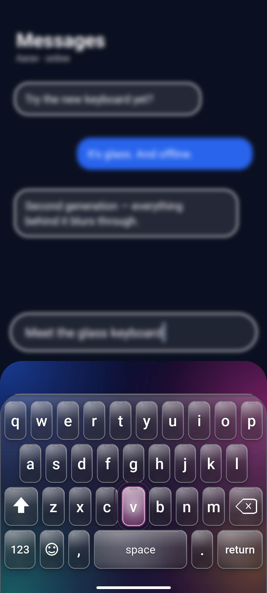
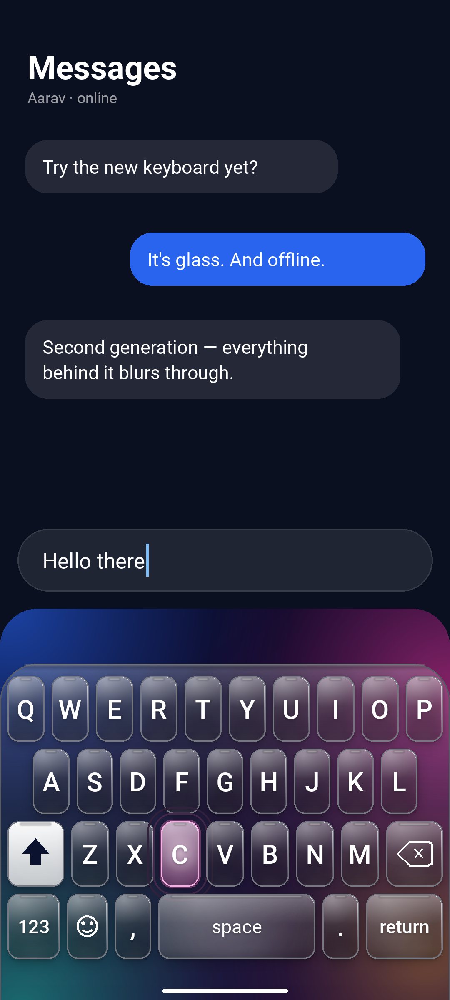
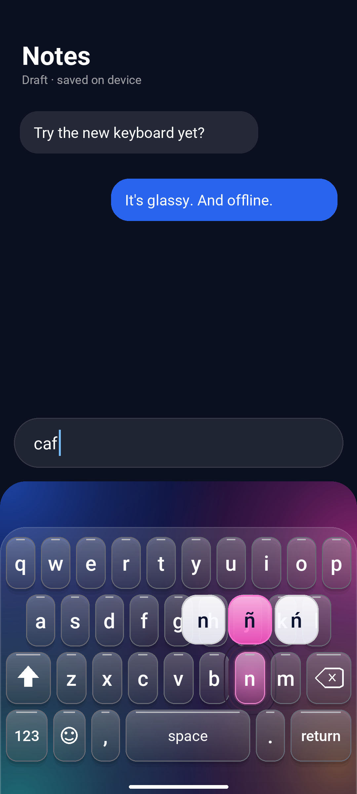
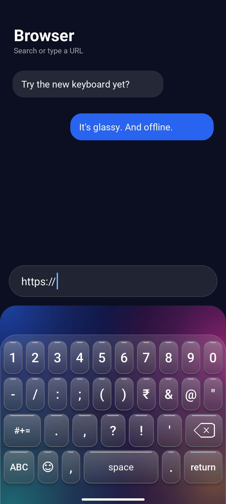
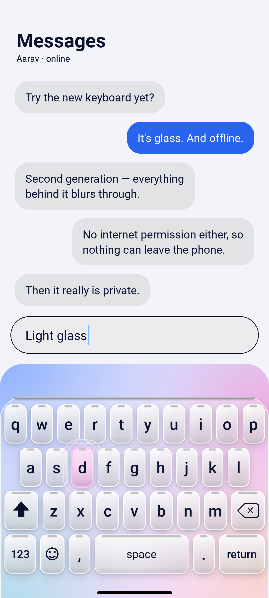
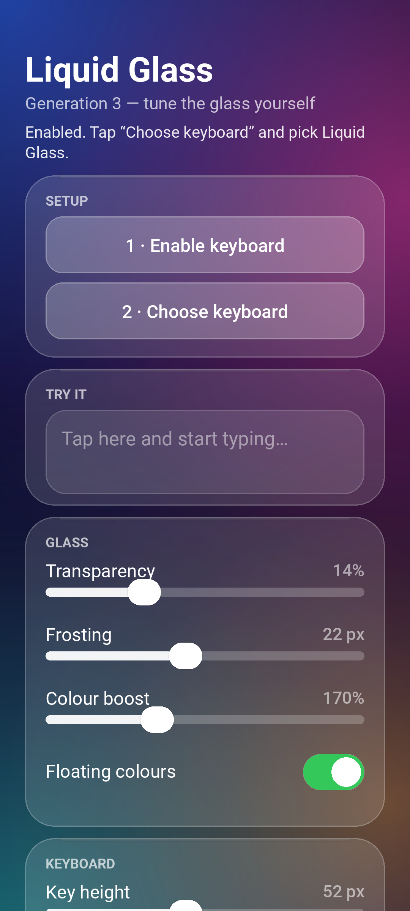

# Liquid Glass Keyboard

A real Android keyboard — a native `InputMethodService`, not a web page in a shell — with a
glassy, colour-shifting keypad. Fully offline: the APK requests no internet permission at all.

[](https://github.com/technicalnihilist-lgtm/liquid-glass-keyboard/actions/workflows/build.yml)
[](LICENSE)
[](#permissions)

<p align="center">
  
  
  
</p>

## Download

**[LiquidGlassKeyboard.apk](https://github.com/technicalnihilist-lgtm/liquid-glass-keyboard/releases/latest/download/LiquidGlassKeyboard.apk)**
— 182 KB, signed, `minSdk 21` (Android 5.0+), `targetSdk 34`. The same file also sits in the repo
root as `LiquidGlassKeyboard.apk`.

Verify the download before installing:

```bash
sha256sum LiquidGlassKeyboard.apk     # compare with SHA256SUMS in this repo
```

Install it, open the app, then:

1. Tap **Enable keyboard** → turn on *Liquid Glass Keyboard* in the system list.
2. Tap **Choose keyboard** → pick *Liquid Glass Keyboard*.

The app shows your live status, so you can tell whether it is enabled and whether it is the
keyboard currently in use. There is a text box on the same screen to try it out immediately.

## Open source

MIT licensed, and small enough to read in one sitting: seven Java files, no dependencies, no
Gradle, no third-party libraries, no generated code. `build.sh` is the entire build system —
`aapt2` for resources, `javac`, `d8` for dexing, `zipalign`, `apksigner`.

That means you can audit the thing that types your messages:

| File | Lines | What it does |
|---|---|---|
| `LiquidImeService.java` | ~190 | the input method: commits text, backspace, enter, asks for window blur |
| `KeyboardView.java` | ~900 | all drawing and touch handling |
| `KeyboardLayout.java` | ~180 | pages, key weights, long-press alternates |
| `GlassPalette.java` | ~150 | colour tokens and preferences |
| `GlassBackdrop.java` | ~70 | gradient sky and drifting orbs |
| `Key.java` | ~50 | one key |
| `SetupActivity.java` | ~200 | enable/choose flow and settings |

Continuous integration builds the APK on every push and **fails if the resulting binary ever
requests the `INTERNET` permission** — the offline promise is enforced by the build, not just by
this paragraph. CI builds are signed with a throwaway key and are for testing only.

Everything needed to rebuild what is published is here: sources, resources, `build.sh`, the icon
generator, the screenshot renderer, and the original HTML mock-up in `design/` that the look came
from. See [CONTRIBUTING.md](CONTRIBUTING.md) to build it yourself, [CHANGELOG.md](CHANGELOG.md)
for what changed when, and [SECURITY.md](SECURITY.md) to report a problem privately.

F-Droid metadata lives in `fastlane/metadata/android/`, so listing the app there needs no extra
work beyond F-Droid's own build recipe.

## Generation 2 — what changed

Version 1 drew each key as a single translucent gradient. Version 2 builds every key out of
layers, the way real glass behaves:

- **Specular rim** along the top edge of each key, blurred so it reads as a reflection rather
  than a line, plus an inner rim that runs bright at the top and fades to nothing at the base.
- **A body that thins downwards** — three gradient stops instead of two, so the key is dense where
  light hits it and almost clear at the bottom.
- **A caustic pool** of light gathering along the base of every key, and a light source in the
  upper left of each pane.
- **Contact shadows** — a tight shadow under the glass and a wide ambient one beneath it, so keys
  sit *on* the sheet instead of floating above it.
- **Real backdrop blur.** On Android 12+ the window asks the system to blur whatever app is
  behind it (`FLAG_BLUR_BEHIND`, 26 dp radius). The keyboard then drops its own paint to a thin
  veil, so you type over a frosted version of the actual screen. Where cross-window blur is
  unavailable it silently falls back to the painted backdrop — nothing breaks.
- **Deeper transparency.** Key bodies are lighter and the plate is thinner, so the colour orbs
  behind the board bleed through the glass instead of being covered by it.
- **Drifting orbs.** The four colour orbs move slowly while the keyboard is visible; switchable in
  settings if you would rather have a still board.
- **Baked rendering.** The static glass (plate and every key body, shadows and rims included) is
  rendered once into a bitmap and reused; only labels, the pressed key and the flare are redrawn
  per frame. More layers, less work per frame than version 1.

## What it does

- Full QWERTY with shift, double-tap caps lock, and automatic capitals at the start of a sentence.
- Three symbol pages (letters, numbers, symbols) plus an emoji page of 48 characters.
- Long-press a key for accented variants — `e` gives è é ê ë ē ė ę, and 16 letters carry alternates.
  Slide to the character you want and let go; the base character is swapped for it.
- Backspace deletes one character, repeats while held, removes whole selections, and steps over
  emoji rather than splitting them in half.
- The return key adapts to the field: it reads *send*, *search*, *go*, *next*, *done* or *prev* and
  triggers the right editor action, falling back to a newline in multi-line fields.
- Every press rotates the accent hue and throws a glow and a colour flare, exactly as the original
  HTML mock-up did — but drawn on a `Canvas` at 60 fps rather than in a browser.
- Popup preview above the key you are pressing, key-click sound and haptic tap (both switchable).
- Dark glass, light glass, or follow the system theme. Three key heights.

## What it deliberately does not do

No predictive text, no autocorrect, no swipe typing, no clipboard history, no cloud anything.
It types what you press and nothing else. Nothing leaves the device, and there is no network code
in the APK to leave with.

## Screenshots

| | |
|---|---|
|  |  |
| Gen 2 glass over a blurred app | Numbers and symbols page |
|  |  |
| Light glass | Setup, live status and preferences |

The screenshots are rendered from the same geometry, colours, gradient stops and rim widths the
keyboard draws with (`tools/render_shots.py` mirrors `KeyboardView`), so they match what the APK
puts on screen. The hero shot shows the Android 12+ backdrop blur; on older versions the board
falls back to its painted backdrop.

## Repository

```
app/
  AndroidManifest.xml          IME service + setup activity
  java/com/liquidglass/keyboard/
    LiquidImeService.java      InputMethodService: commits text, window blur, enter/backspace
    KeyboardView.java          layered glass drawing, baked bitmap, touch, glow and flare
    KeyboardLayout.java        every page's rows, weights and long-press alternates
    GlassPalette.java          colour tokens, HSL helper, preferences
    GlassBackdrop.java         gradient sky + drifting colour orbs
    SetupActivity.java         enable/choose flow, live status, preferences
  res/                         styles, glass drawables, layout, launcher icons, IME metadata
build.sh                       aapt2 → javac → d8 → zipalign → apksigner
tools/                         icon generator and screenshot renderer
design/                        the original HTML mock-up, kept for provenance
fastlane/                      F-Droid metadata
.github/workflows/build.yml    CI: build, verify permissions, upload artifact
```

To build it yourself:

```bash
export JAVA_HOME=/path/to/jdk-17
export ANDROID_HOME=/path/to/android-sdk     # needs build-tools 34.0.0 and platforms/android-34
bash build.sh
```

The signing key is created on first run at `~/.liquidglass/keyboard.jks` (override with `KS` and
`KSPASS`). Replace it with your own key if you plan to publish — builds signed with a different key
cannot update over this one.

## Permissions

`VIBRATE` only. There is no `INTERNET` permission, so the app cannot phone home even in principle.

## Licence

MIT — see [LICENSE](LICENSE). Every source file carries the licence header. Use it, fork it,
ship it in a product; just keep the copyright notice.
